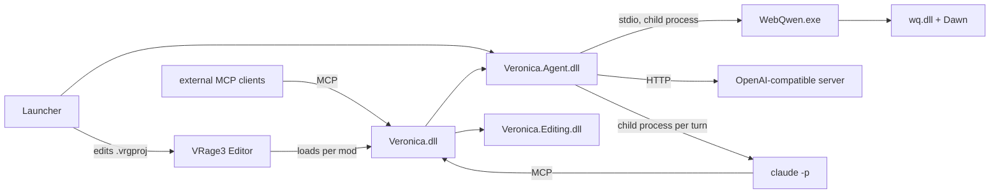

# Tech

Architecture and the decisions the code cannot tell.

## Belongs here

- Components, their boundaries, and how they connect.
- Decisions a reader could not recover from the code, with their reasons. Above all reasons that stop a future change from bringing a solved problem back.
- Constraints of the engine, the Editor, the GPU or a provider that shape the design.
- A constant when the feature depends on it or the decision makes sense only with it.
- The testing rules, in [Testing.md](Testing.md).

## Does not belong here

- What the user sees: `Docs/Spec`.
- How the code works: algorithms, schemas, message texts, defaults, paths. The code holds them and docs restating them go out of sync.
- Per-feature test lists: the tests are the record.
- History, dates, eval narratives. A reason earned in an eval stays as the reason, in one clause.
- Filler. A component with little to decide has a short file.

## Components

## Files

| file | scope |
|---|---|
| [Testing.md](Testing.md) | How any feature is tested |
| [Agent.md](Agent.md) | Provider abstraction, tool loop, conversation, questions to the user |
| [WebQwen.md](WebQwen.md) | The local model runtime and its provider |
| [OpenAiProvider.md](OpenAiProvider.md) | The OpenAI-compatible server provider |
| [ClaudeProvider.md](ClaudeProvider.md) | The Claude Code provider |
| [McpEndpoint.md](McpEndpoint.md) | The tools served over MCP |
| [Tools_Overview.md](Tools_Overview.md) | The tool contract and the editing layer under every Editor tool |
| [Tools_Readers.md](Tools_Readers.md) | Tools that find and read content |
| [Tools_Writers.md](Tools_Writers.md) | Tools that change existing content |
| [Tools_Creators.md](Tools_Creators.md) | Tools that create content |
| [Board.md](Board.md) | Showing items and graphs to the user |
| [Context.md](Context.md) | General rules for what the model is told; the system prompt |
| [Skills.md](Skills.md) | Skills and plans |
| [Wiki.md](Wiki.md) | Wiki pages, the researcher, subagents |
| [Compaction.md](Compaction.md) | The conversation going on past a full context window |
| [VramSharing.md](VramSharing.md) | The Editor and the local model taking turns on one GPU |
| [EditorPlugin.md](EditorPlugin.md) | The plugin inside the Editor: loading, build, UI |
| [Distribution.md](Distribution.md) | Release, the Launcher, install layout, settings, updates |
| [Eval.md](Eval.md) | Eval runs of the assistant in the Editor |
