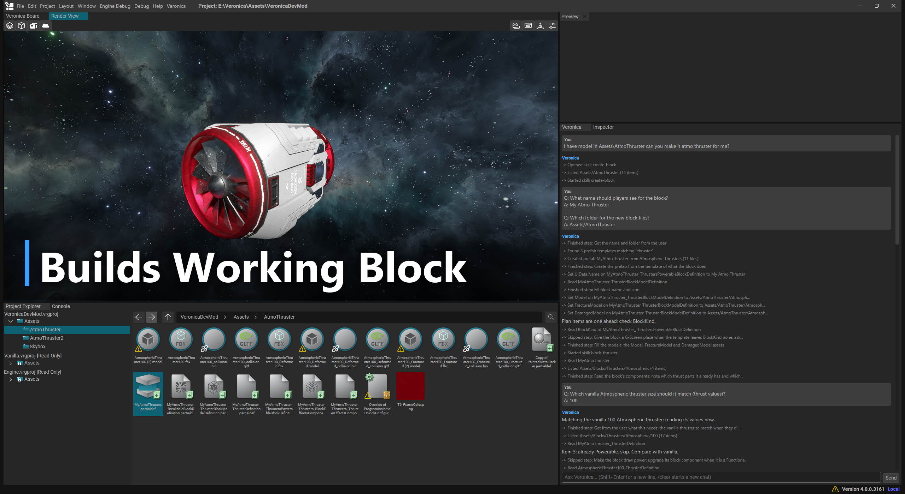
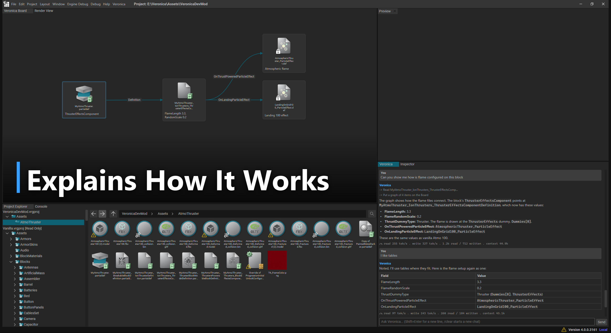
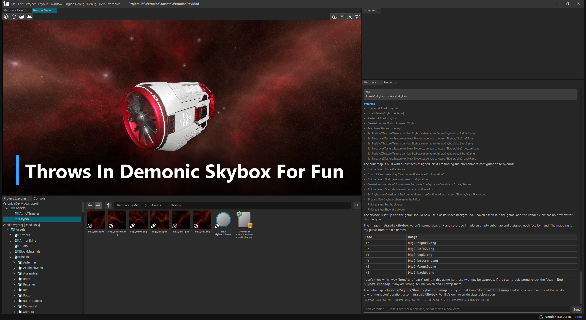

# Veronica

Your SE2 Modding Co-Engineer *You have vision, Veronica knows how to click it in.*

  
  
  

## Pick your setup

**New to AI-assisted development?** 
No problem. Three clicks install everything, no subscriptions or third-party services [needed](../../wiki/AI-providers#built-in-model).

**Already have an AI subscription?** 
Great. [Claude](../../wiki/AI-providers#claude-code), [Codex](../../wiki/AI-providers#claude-app-codex-app-or-any-mcp-capable-harness) or [any other MCP harness](../../wiki/AI-providers) can be connected and get full access to [Skills](../../wiki/Skills) and [Wiki Knowledge](../../wiki/Game-knowledge).

## Get started

1. Download the Launcher from the [Latest Release](../../releases/latest)
2. Run it, the First-Run Guide will get you set up real quick
3. Start the Editor and chat

## Quick links

- [Wiki](../../wiki): Setup, Providers, everything you want to know
- [Skills](../../wiki/Skills): Because every engineer likes checklists
- [Game knowledge](../../wiki/Game-knowledge): Comprehensive knowledge of SE2 Content and correct setup routines
- [Eval tasks](../../wiki/Eval-tasks): Practice makes perfect

## Found a bug?

Or missing feature? Report it in [Issues](../../issues).
