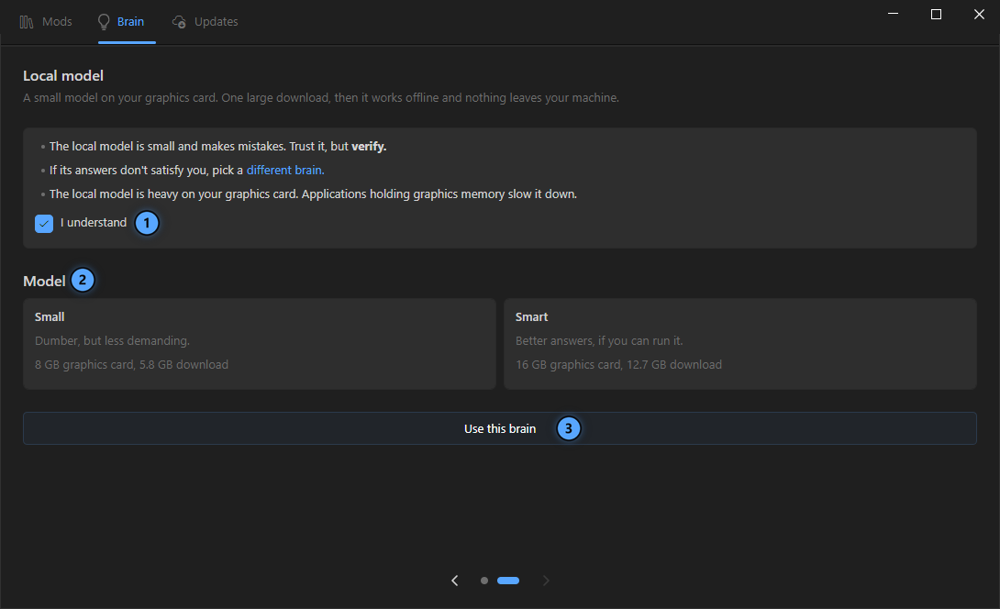
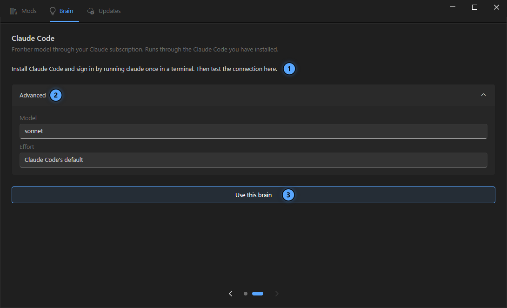
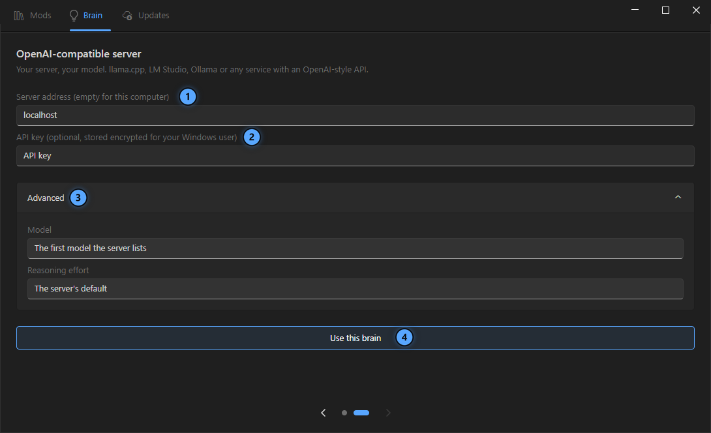
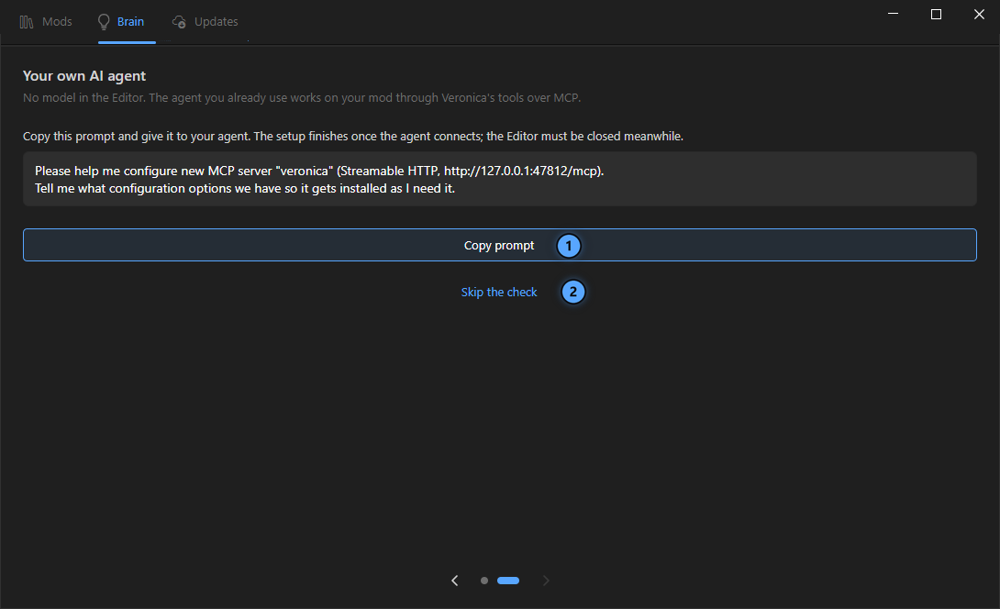

Veronica needs an AI source to think. There are a number of options, choose one that fits your needs

## Built-in model

Free and private, runs on your graphics card, works offline, nothing leaves your machine

**Requirements**
- Windows with an AMD or NVIDIA graphics card (D3D12)
- **Small** model: 8 GB graphics card. **Smart** model: 16 GB graphics card

**Setup**

1. Read the notes and tick **I understand**
2. Pick **Small** or **Smart**. The download starts right away
3. Once it finishes, click **Use this brain**

## Claude Code

A frontier model through your Claude subscription

**Requirements**
- A Claude account
- [Claude Code](https://claude.com/claude-code) installed

**Setup**

1. Install Claude Code, run `claude` once in a terminal and sign in
2. Optional: under **Advanced**, choose the model and the effort
3. Click **Use this brain**. The Launcher checks that Claude Code answers

## OpenAI-compatible server

Your server, your model: llama.cpp, LM Studio, Ollama, or a hosted service such as OpenAI, OpenRouter or DeepSeek

**Requirements**
- A server speaking the OpenAI chat completions API
- A model that supports tool calling

**Setup**

1. Enter the server address. Leave it empty for a server on this computer; a host name alone is enough, the Launcher finds the server
2. Enter the API key if your server needs one. It is stored encrypted for your Windows user
3. Optional: under **Advanced**, choose the model and the reasoning effort
4. Click **Use this brain**. The Launcher checks that the server answers

## Claude app, Codex app or any MCP-capable harness

No chat inside the Editor. The agent you already use, in its own window, equipped with Veronica's tools, skills and wiki knowledge

**Requirements**
- An AI agent that can connect to an MCP server (Streamable HTTP)

**Setup**

1. Click **Copy prompt** and give it to your agent. It walks you through adding Veronica as an MCP server; Launcher automatically detects successful connection
2. To connect your agent later, click **Skip the check**

Then open your mod in the Editor and talk to your agent as usual

### Note
Most harnesses don't support MCP connection mid-session, so start Editor first, then your harness/Agent app
