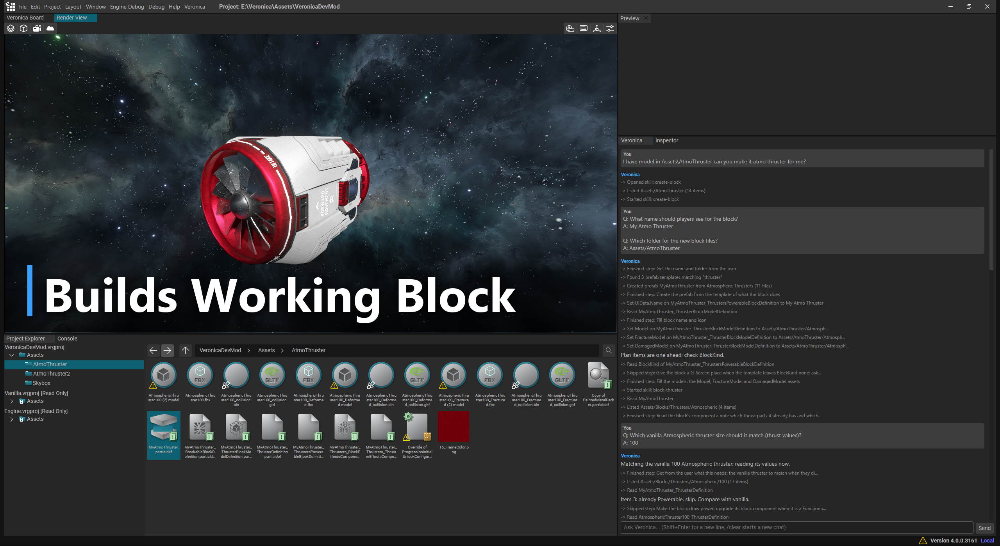
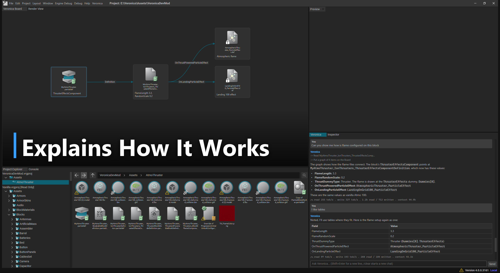
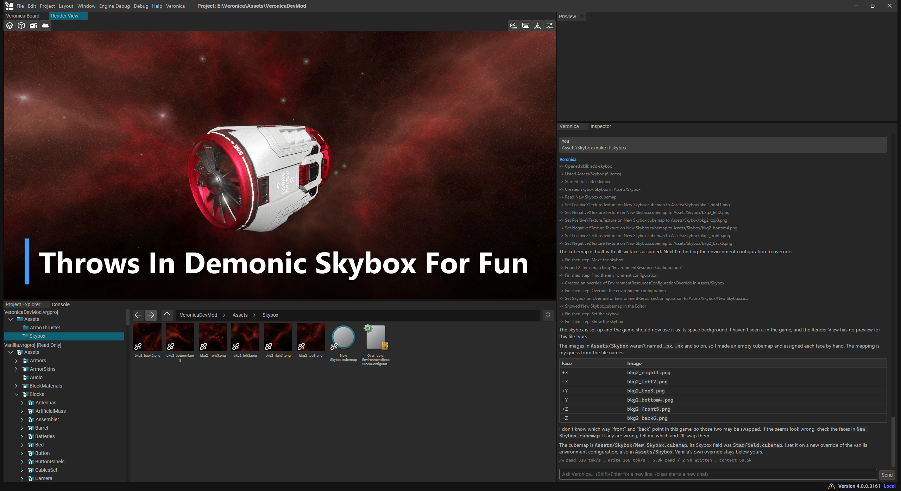

# Veronica
Your SE2 Modding Co-Engineer *You have vision, Veronica knows how to click it in.*

## What you need

- Space Engineers 2 Mod SDK from [Steam](https://store.steampowered.com/app/1133870/Space_Engineers_2/).
- [AI provider](AI-providers) (one of):
  - **Built-in model:** Free and private, runs on your graphics card.
  - **Claude Code:** Your Claude subscription.
  - **OpenAI-compatible server:** Your own server or a hosted service.
  - **Your own AI agent:** Claude app, Codex app or any MCP harness.

## Install

1. Download the Launcher from the [Latest Release](../releases/latest).
2. Run it, pick an install folder, follow on-screen instructions.
3. Start Editor, new interactive panel will appear directly in Editor

## What Veronica knows

- [Skills](Skills): Optimized checklists for swift task execution.
- [Game knowledge](Game-knowledge): Broad knowledge database about SE2, how data are structured, where to look for Vanilla values, ...
- [Eval tasks](Eval-tasks): The task list Veronica is trained on and expected to flawlessly execute every single time
